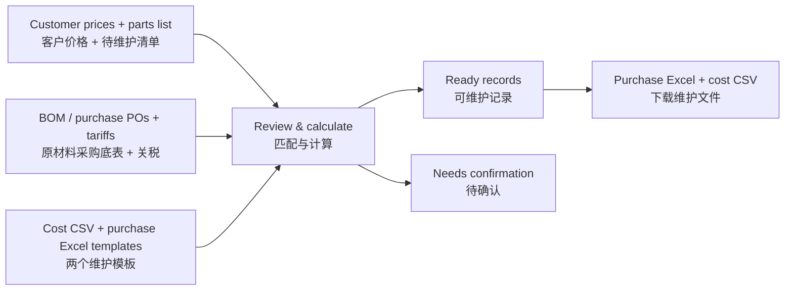

# Material maintenance / 原材料价格维护

Prepare purchase-price Excel and standard-cost CSV files from reviewed customer prices, BOM / purchase POs, tariffs and existing maintenance templates.

根据客户当前价、BOM／采购 PO、关税底表及现有模板，生成采购价格 Excel 和标准成本 CSV。

## Use / 使用

1. Select the review period. Upload the parts list (`Part No` + `Revision`; `Rev` and `Part Revision` also work).
2. Upload the original Plex customer-price base, or select the **Current PO export** input mode. A Current PO export must use the same as-of date as the period end.
3. Upload the BOM / purchase PO export, tariff workbook, original standard-cost CSV and original purchase-price `.xlsx` template.
4. Review detected sheets, header rows and column mappings. Near spellings are suggestions requiring selection; duplicate aliases are not guessed.
5. Review ready and pending records. Download both maintenance files and the optional review workbook. No Plex updates are performed by this tool.

先上传零件清单，可下载已经填好清单的只读 SQL。运行该 SQL 并导出结果后，上传到 BOM／采购 PO 底表栏。标准成本模板使用原始 CSV；采购价格模板使用原始 `.xlsx`，默认保留前两行表头。异常记录不会写入维护文件。

## Rules / 规则

- Part + specified revision; blank means blank, numeric one-digit revision pads to two digits.
- BOM: use only `BOM_Active = 1` components. Explicit finished-part fallback rows retain their blank BOM fields.
- Purchase PO: `Blanket_Order = 1`; PO status `On Order`; line status excludes `Cancelled` and `Closed` (`Requisition` is allowed). Multiple candidates require confirmation.
- Import country is fixed to the United States. Export country follows the selected purchase supplier: Thailand → Thailand; Macao → China. Tariffs match the finished or material part number within that route. Missing supplier-country rates remain pending; another country is never substituted.
- Tariff rounds half up to 2 decimals. Settlement ratio = `ROUND(factor / (1 + tariff), 2)`, Thailand factor `0.91`, China `0.93`.
- Target purchase price = `ROUND(customer price × ratio, 4)`.
- `Material.Material` = target purchase price; `Material.Tariff` = target purchase price × rounded tariff, with no further rounding.
- Purchase effective date follows the selected customer price; when same-price customer POs have several effective dates, use the latest. Expiration is December 31 of the current year.
- Macao supplier: CIP; other supplier: CIF. Buying plant: Tawas City.
- Conflicting tariffs, multiple Operations, shared-material conflicts, unknown country factors and unresolved source values require confirmation. They are not assigned a guessed value.

## Run locally / 本机运行

Run `python -m http.server 8788 --bind 127.0.0.1` in the published repository folder, then open `http://127.0.0.1:8788/` in Edge or Chrome. The standalone GitHub Pages version uses the same `dist` files.

Tests: `node --test material.test.mjs`. No build step. Customer-price selection uses an isolated copy of engine 4.7.0; the customer-price review website is unchanged.

No-BOM mappings explicitly marked `Finished part fallback` may retain a blank BOM quantity. No quantity is invented. Invalid numeric-field warnings identify the field.
