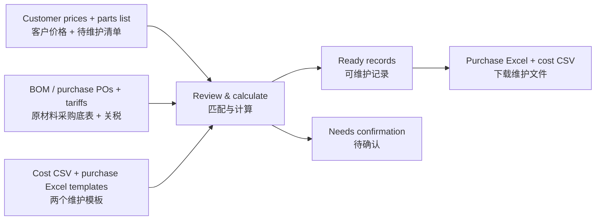

# Material maintenance / 原材料价格维护

Prepare purchase-price Excel and standard-cost CSV files from reviewed customer prices, BOM / purchase POs, tariffs and existing maintenance templates.

根据客户当前价、BOM／采购 PO、关税底表及现有模板，生成采购价格 Excel 和标准成本 CSV。

## Use / 使用

1. Select the review period. Upload the parts list (`Part No` + `Revision`; `Rev` and `Part Revision` also work).
2. Upload the original Plex customer-price base, or select the **Current PO export** input mode. A Current PO export must use the same as-of date as the period end.
3. Upload the BOM / purchase PO export, tariff workbook, either the original standard-cost CSV or the original purchase-price `.xlsx` template, or both.
4. Review detected sheets, header rows and column mappings. Near spellings are suggestions requiring selection; duplicate aliases are not guessed.
5. Review ready and pending records. Download both maintenance files and the optional review workbook. No Plex updates are performed by this tool.

先上传零件清单，可下载已经填好清单的只读 SQL。下载的 SQL 同时填入所选期间结束日，采购行须在该日有效（空白日期不限期）。运行该 SQL 并导出结果后，上传到 BOM／采购 PO 底表栏。标准成本模板使用原始 CSV；采购价格模板使用原始 `.xlsx`，默认保留前两行表头。异常记录不会写入维护文件。

## Rules / 规则

- Part + specified revision; blank means blank, numeric one-digit revision pads to two digits.
- BOM: use only `BOM_Active = 1` components. Explicit finished-part fallback rows retain their blank BOM fields.
- Purchase PO: `Blanket_Order = 1`; PO status `On Order`; line status excludes `Cancelled` and `Closed` (`Requisition` is allowed). Line effective / expiration dates must include the selected review period end (inclusive; blank dates are unbounded). Multiple candidates require confirmation.
- Import country is fixed to the United States. Export country follows the selected purchase supplier: Thailand → Thailand; Macao → China. Tariffs match the finished or material part number within that route. Missing supplier-country rates remain pending; another country is never substituted.
- Tariff rounds half up to 2 decimals. Settlement ratio = `ROUND(factor / (1 + tariff), 2)`, Thailand factor `0.91`, China `0.93`.
- Target purchase price = `ROUND(customer price × ratio, 4)`.
- `Material.Material` = target purchase price; `Material.Tariff` = target purchase price × rounded tariff, with no further rounding.
- Purchase effective date follows the selected customer price; when same-price customer POs have several effective dates, use the latest. Expiration is December 31 of the current year.
- Macao supplier: CIP; other supplier: CIF. Buying plant: Tawas City.
- Conflicting tariffs, multiple Operations, shared-material conflicts, unknown country factors and unresolved source values require confirmation. They are not assigned a guessed value.

## Run locally / 本机运行

Run `python -m http.server 8788 --bind 127.0.0.1 --directory dist` in this folder, then open `http://127.0.0.1:8788/` in Edge or Chrome. The standalone GitHub Pages version uses the same `dist` files.

Tests: `node --test tests/*.test.mjs`. No build step. Customer-price selection uses an isolated copy of engine 4.8.1; the customer-price review website is unchanged.

No-BOM mappings explicitly marked `Finished part fallback` may retain a blank BOM quantity. No quantity is invented. Invalid numeric-field warnings identify the field.

Checks run independently: unresolved customer prices or purchase lines do not stop tariff matching. Pending reasons are deduplicated into one concise row per part and revision. An unknown supplier route remains pending.

客户价、采购行无法确认时仍检查关税；每个零件版本汇总一行简短原因。无法确定出口国时列待确认。

GM price checks follow the separate GM group comparison; zero Releases / Shipped does not itself create a confirmation. / GM 客户价独立按组比较，Releases／Shipped 双零本身不触发待确认。

Download both SQL templates directly under **Upload files**: `Plex_export.sql` for customer prices, and `Material_mapping_purchase.sql` for BOM / purchase POs. The customer-price SQL matches the price-review tool and preserves full price history. / “上传文件”区域可直接下载客户价格 SQL 和 BOM／采购 PO SQL，客户价格模板与客户价格工具一致，保留完整售价历史。

## Manual customer-price review / 人工确认客户价

When resolved non-GM customer quotes disagree, open **Needs confirmation**, choose an existing quote (price, customer, PO and effective date), then click **Confirm selected price**. All applicable BOM, purchase-line, tariff and selected-template checks run again. Only passing records enter both maintenance downloads. **Undo confirmation** restores automatic review. Changing source files, column mappings or review dates clears confirmations. Review Excel includes a price-confirmation sheet with the chosen quote, alternatives and confirmation time.

非 GM 的已有客户当前价冲突时，可在“待确认”中选择一条候选价并确认。其他检查也通过才进入两个维护模板；可撤销。修改底表、字段对应或期间后清空确认。核对明细 Excel 保留选中价、候选价和确认时间。此入口仅处理已有、已确定的候选价，不替代 GM 组比价或未确定的 PO 有效价。

Maintenance templates are independent: upload the cost CSV, purchase Excel, or both. With both selected, unresolved cost Operations affect only the cost output. Purchase Excel excludes lines whose current `Purchase_Unit_Price` and target price round half up to the same four-decimal amount; these remain in the review workbook under **Unchanged purchase**. Standard-cost output is evaluated separately. At least one maintenance template is required.

两个维护模板可任选其一或同时上传；成本行问题不影响采购文件。采购行现价与理论价四舍五入至四位后相同，则不导出采购更新，核对明细保留“采购同价”页；标准成本独立判断。
